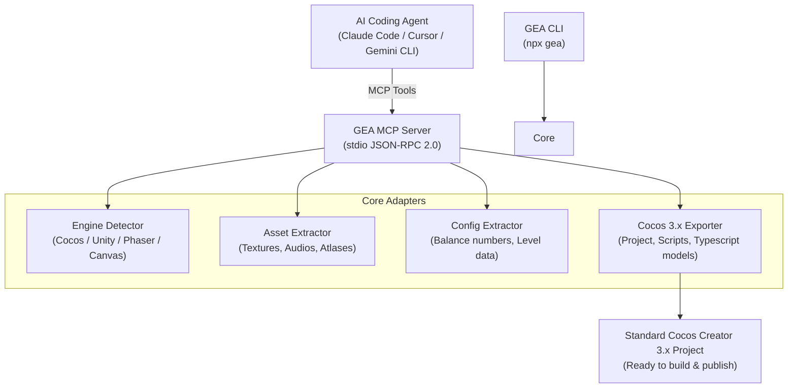

<div align="center">

# GEA: Game Engineer Anything

### One MCP & CLI for game reverse engineering, asset extraction, and Cocos/Godot recreation.

**See a game mechanic you like. Unpack the assets, analyze the balance data, and port it into your own Cocos Creator / Godot project.**

[](https://opensource.org/licenses/MIT)
[](https://modelcontextprotocol.io/)
[](https://www.cocos.com/)
[](https://nodejs.org/)

*Inspired by [morluto/rea](https://github.com/morluto/rea) (Reverse Engineer Anything)*

---

</div>

## 🌟 Overview (项目简介)

**GEA (Game Engineer Anything)** 是一个专为 AI 编码智能体（Claude Code, Cursor, Antigravity, Gemini CLI 等）与游戏开发者打造的**跨平台小游戏拆解、资产提炼与 Cocos/Godot 移植框架**。

### 为什么需要 GEA？
做海外小游戏（Poki, CrazyGames, Google Play, Telegram Mini Apps）或休闲游戏时，最快验证爆款的方法是拆解成熟竞品。但市面上的游戏逆向工具分散割裂（引擎识别、SpriteSheet 切图、Protobuf/JSON 配置提取、引擎项目模板搭建），门槛极高。

GEA 将游戏逆向工程、静态分析和资产管线封装为统一的 **Model Context Protocol (MCP)** 服务，让 AI 智能体可以像顶级主程一样：
1. **自动侦测游戏引擎**（Cocos Creator、Unity WebGL、Phaser、Pixi 等）；
2. **自动化提取与分类美术资产**（高清 Sprite、背景纹理、音频、图集）；
3. **抽取游戏核心数值与关卡配置**；
4. **一键重构为可直接在 Cocos Creator 3.x 打开的标准化游戏工程**。

---

## 🏗️ Architecture (核心架构)



---

## ⚡ Quick Start (快速开始)

### 1. 命令行 CLI 使用 (CLI Usage)

```bash
# 1. 侦测目标游戏所属引擎
npx gea inspect ./sample-game

# 2. 提取并智能分类游戏美术贴图与音频
npx gea extract ./sample-game -o ./unpacked-assets

# 3. 将提取的资产一键转译为 Cocos Creator 3.x 工程
npx gea port ./unpacked-assets -o ./MyCocosGame
```

### 2. 作为 MCP 服务供 AI 智能体调用 (Agent MCP Setup)

在你的 Claude Desktop / Cursor / Antigravity 配置中加入：

```json
{
  "mcpServers": {
    "gea": {
      "command": "node",
      "args": ["C:/path/to/gea/src/server.js"]
    }
  }
}
```

挂载后，AI 智能体即可直接调用以下工具：
* `gea_inspect_target`: 侦测目标游戏引擎类型与指纹
* `gea_extract_assets`: 批量提取并分类游戏纹理与音效
* `gea_export_to_cocos`: 自动生成标准 Cocos Creator 项目

---

## 🛠️ Provided MCP Tools (工具规范)

| Tool Name | Parameters | Description |
| :--- | :--- | :--- |
| `gea_inspect_target` | `targetPath` | 深度扫描游戏目录，输出引擎分类与置信度报告 |
| `gea_extract_assets` | `sourcePath`, `outputPath` | 扫描并提取所有 `.png`, `.webp`, `.ogg`, `.wav` 资产 |
| `gea_export_to_cocos` | `assetSourceDir`, `cocosProjectDir`, `configData` | 将素材与数值表生成为标准 Cocos 3.x 结构 |

---

## 📄 License

MIT License © 2026 GEA Open Source Team. Inspired by [morluto/rea](https://github.com/morluto/rea).
